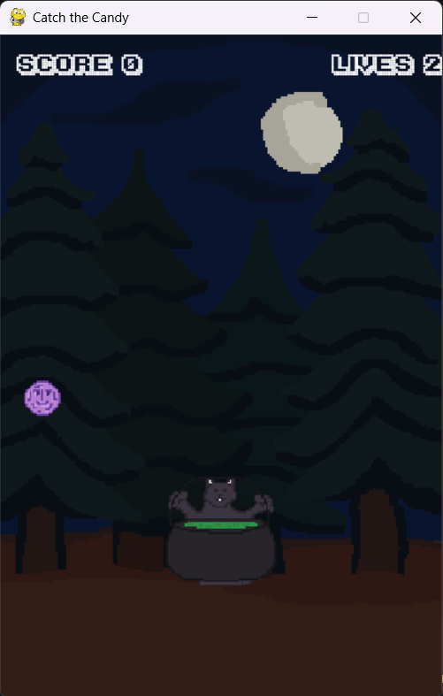

# Catch a Candy!
## About The Project

A submission for Snek, a Hack Club YSWS. Catch a Candy is a simple "Apple and Basket" style game with a Halloween twist. 
Here, the player is a cat holding a cauldron, and must attempt to catch purple falling candies from the sky. 
Through this project, I experimented with game design, and pixel art, which are things that are often ignored in my current Computer Science courses.

<div align="center">
    
</div>

See `/assets` to see my designs!

### Built With

Language - Python


Library - Pygame

## Getting Started

To get a local copy up and running follow these simple example steps.

### Prerequisites

* python

    Can’t have Pygame without Python! If you haven’t already, download and install it at [https://python.org](https://python.org)

* pygame & installer
  ```sh
  pip install pygame-ce
  pip install pyinstaller
  ```

### Installation

_Below is an example of how you can instruct your audience on installing and setting up your app. This template doesn't rely on any external dependencies or services._

1.  Clone the repo
   ```sh
   git clone https://github.com/g8mero/catch-a-candy
   ```
2. Navigate to game folder and run
```sh
pyinstaller --clean --onefile --add-data "assets;assets" main.py 
```
3. Open .exe file in ./dist.


## Acknowledgments

 * Font [Karmatic Arcade](https://www.1001fonts.com/download/karmatic-arcade.zip)
 * All other assets where drawn digitally on [Piskel App](https://www.piskelapp.)


[Bootstrap.com]: https://img.shields.io/badge/Bootstrap-563D7C?style=for-the-badge&logo=bootstrap&logoColor=white
[Bootstrap-url]: https://getbootstrap.com
[JQuery.com]: https://img.shields.io/badge/jQuery-0769AD?style=for-the-badge&logo=jquery&logoColor=white
[JQuery-url]: https://jquery.com 
